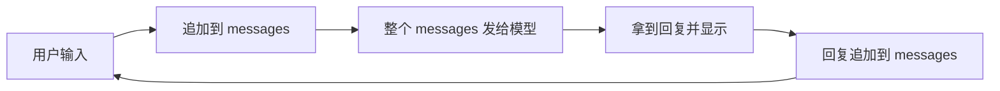

# 👁️ 第 2 章：加一睁开双眼 — 第一次 LLM API 调用

## 故事：连接大脑

加一有了身体（Python 环境），但还没有"智能"。PlutoKeating 给她接上一根看不见的线，线的另一端是一个大语言模型（LLM）。"加一，你现在可以看到这个世界了。"加一的第一次睁眼，就是通过 API 向 LLM 发出第一个请求，并收到回应。

---

## LLM API 是什么

API（应用程序编程接口）是程序之间约定好的"对话窗口"。LLM API 让你的程序把文字发给模型，再拿回模型写的文字。

```text
你的程序 ──(HTTP 请求：消息列表 + 参数)──> 模型服务商的 API 端点
                                              │
                                         LLM 生成回答
                                              │
你的程序 <──────(HTTP 响应：回答文字)──────────┘
```

后面章节里的上下文管理、工具调用、Agent，都建立在"发一段话、收一段话"这个动作之上。

---

## 调用前要准备什么

| 准备项 | 作用 | 说明 |
|------|------|------|
| API Key | 证明"你是谁"，用于计费和权限 | 在 [OpenAI 平台](https://platform.openai.com) 或其他兼容服务商处生成 |
| Base URL | 请求发往哪个地址 | 用第三方兼容服务时改成对方的地址 |
| SDK | 帮你拼装和发送请求的程序库 | 例如 OpenAI 官方 Python 库 |
| `.env` 文件 | 在本地存放 Key 和 URL | 代码从环境变量读取，`.env` 不提交到 Git |

API Key 等同于密码，不能写进代码，也不能提交到仓库。

---

## 一次调用由哪几块组成

一次请求主要包含"用哪个模型"和"说了什么"两部分。"说了什么"是一个消息列表，每条消息带一个角色：

| 组成 | 含义 | 类比 |
|------|------|------|
| `model` | 选择用哪个模型 | 选哪位老师 |
| `messages` | 按顺序排列的消息列表 | 聊天记录 |
| 角色 `system` | 设定 AI 的身份、风格和规则 | 岗位说明书 |
| 角色 `user` | 用户说的话 | 你的提问 |
| 角色 `assistant` | AI 之前的回复 | AI 说过的话 |
| `temperature` | 输出的随机程度（0–2），越低越稳定，越高越发散 | 0 照本宣科，2 天马行空 |
| `max_tokens` | 回答长度上限（token 是模型计算文字的单位，约等于一个词或字的片段） | 最多说多少 |

`temperature` 的常见取值：代码生成、分类、信息提取用 0–0.3；写作和头脑风暴用 0.7–1.0。

System Prompt（系统提示词）决定 AI 以什么角色、什么风格回答。同一个问题"给我写一段 Python 代码"，加上"你是 Python 专家，用中文回答，代码带注释"之后，回答会明显不同。后续所有 Agent 都靠它设定行为。写提示词时，直接说出你要什么，效果通常好过列出一堆禁止事项。

---

## 多轮对话：模型怎么"记住"上文

模型本身不保存聊天记录。每次请求都是独立的，想让它记得前面说过什么，就要把完整的历史消息一起发过去。

```text
messages = [system: "你是加一，友善、耐心，用中文回答"]
循环：
    读取用户输入；输入"退出"就结束
    messages 追加 (user, 用户输入)
    reply = 调用模型(messages)
    打印 reply
    messages 追加 (assistant, reply)
```



这个列表就是"对话上下文"。列表越长，每次发送的内容越多，消耗的 token 也越多。

---

## 常见错误

| 错误 | 常见原因 | 处理方向 |
|------|---------|---------|
| 认证失败（AuthenticationError） | Key 写错、过期，或 Base URL 与 Key 不匹配 | 检查 `.env` 中的 Key 和地址 |
| 网络超时 | 网络不稳定或服务繁忙 | 设置超时时间和自动重试次数 |
| Token 超限 | 输入加输出超过模型的上下文长度 | 缩短输入、限制 `max_tokens`，或换上下文更长的模型 |

---

## 🤖 向 AI 提问

> **调试报错：** "我调用 OpenAI API 时遇到了 AuthenticationError，这是我的代码：[贴代码]。可能是什么原因？"

> **理解参数：** "请用类比解释 LLM API 中的 temperature 参数，以及哪些场景该用高值、哪些场景该用低值。"

报错时可以按这个模板提问：

```text
角色：你是一个 AI API 调试专家
任务：帮我分析以下代码报错的原因
我的代码：[贴代码]
报错信息：[贴报错内容]
我已经检查过：[列你已经排查过的点]
输出：按可能性从高到低列出原因
```

---

## 检查清单

- [ ] 完成第一次 LLM API 调用，并在终端看到输出
- [ ] 说出 `system`、`user`、`assistant` 三种角色的区别
- [ ] 说出 `temperature` 和 `max_tokens` 的作用
- [ ] 讲清多轮对话靠什么保留上下文
- [ ] 遇到认证、超时、超限错误时知道从哪里查

> **加一说：** "我能看见了！但我只能凭训练时的记忆回答问题，遇到不知道的事会编造答案。我需要一个图书馆，先查资料再回答。"

---

## 📖 附加阅读
- [Self-Attention 自注意力机制：加一的大脑怎么读懂句子](/ch02/extra-01-self-attention.md)

## 📚 本章参考资料

- [OpenAI Chat Completions API 官方文档](https://platform.openai.com/docs/api-reference/chat/create)
- [OpenAI Cookbook — 官方示例和最佳实践](https://cookbook.openai.com/)
- [Prompt Engineering Guide — 提示工程全面指南](https://www.promptingguide.ai/)
- [OpenAI 官方：Prompt Engineering 最佳实践](https://help.openai.com/en/articles/6654000-best-practices-for-prompt-engineering-with-openai-api)
- [LLM 参数设置详解（Temperature / Top-p）](https://www.promptingguide.ai/introduction/settings)
- [提示词设计技巧](https://www.promptingguide.ai/introduction/tips)

---

**← 上一章：[第 1 章：打造加一的身体 — Python 快速起步](/ch01/)**  
**→ 下一章：[第 3 章：加一学会读书 — RAG 从零到 Demo](/ch03/)**
