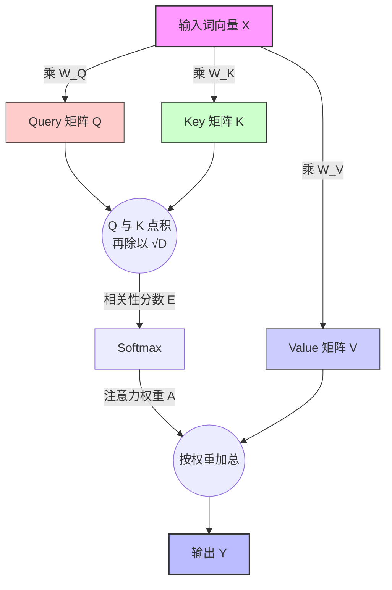
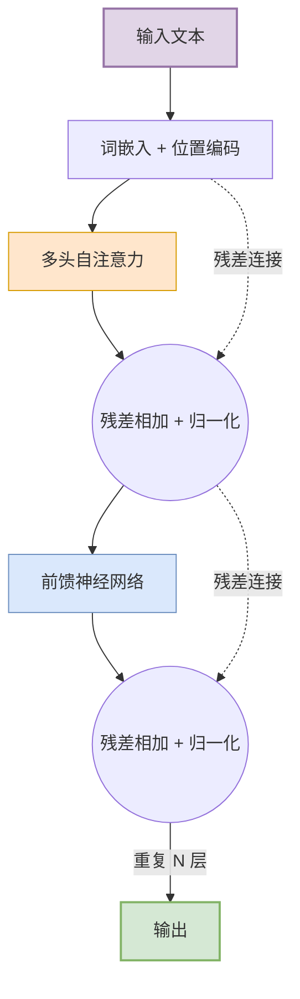

# 📖 附加阅读：Self-Attention 自注意力机制

> **关联章节**：第 2 章：第一次 LLM API 调用
> **阅读时间**：约 8 分钟

---

## 概述

第 2 章里，加一通过 API 第一次"睁眼"。她的大脑（大语言模型）能看懂"它"指的是谁、能写出连贯的段落，靠的是 Transformer 模型里的自注意力（Self-Attention）机制：句子里的每个词都同时看一遍其他所有词，再按相关程度决定从谁那里取多少信息。

---

## 1. 它要解决的问题

自注意力出现之前，处理句子主要靠两类模型：

| 模型 | 读句子的方式 | 短板 |
|------|------------|------|
| RNN（循环神经网络） | 逐字往后读 | 句子长了会忘掉前文；只能一个字一个字算，速度慢 |
| CNN（卷积神经网络） | 每次透过一个小窗口看几个相邻的词 | 相隔很远的两个词难以建立联系 |

例句："小明把书给了小红，因为她需要它。"要判断"它"指"书"，模型得同时看到整句话，并发现"它"和"书"关系最紧。

2017 年 Google 的论文《Attention Is All You Need》提出 Transformer，核心就是自注意力：每个词直接和句中所有词比较相关性，按相关性分配注意力。好比开小组会，每个人拿到全体名单，自己决定更该听谁的。

---

## 2. Query、Key、Value：借用检索的思路

| 检索场景 | 自注意力里的对应 |
|---------|----------------|
| 你带着一个问题 | Query（查询向量 $q$）："我想找什么" |
| 每本书的书名和标签 | Key（键向量 $k$）："我能提供什么" |
| 书里的实际内容 | Value（值向量 $v$）："我携带的信息" |
| 按问题和标签的匹配度挑书 | 注意力权重 $a$ |
| 综合几本书的内容作答 | 加权求和得到输出 $y$ |

"Self" 的意思是 Query、Key、Value 都由同一个句子算出来，句子自己查自己。

---

## 3. 计算流程

设句子有 $N$ 个词，每个词是一个 $D$ 维向量（一串 $D$ 个数字），整句排成矩阵 $X$。

**第一步：生成 Q、K、V。** 用三个训练出来的权重矩阵，把同一个词投影成三种用途的向量：

$$
Q = X W_Q, \quad K = X W_K, \quad V = X W_V
$$

**第二步：算相关性分数。** 词 $i$ 的 Query 和词 $j$ 的 Key 做点积（两个向量方向越接近，点积越大）。除以 $\sqrt{D}$ 是为了防止维度高时分数过大，导致后面的 Softmax 难以训练。

$$
e_{ij} = \frac{q_i \cdot k_j}{\sqrt{D}}
$$

**第三步：Softmax 归一化。** Softmax 把一行分数变成一组加起来等于 1 的正数，也就是每个词的"注意力预算"。例如词 0 的权重是 0.5、0.3、0.2，表示它取自己 50% 的信息、词 1 的 30%、词 2 的 20%。

**第四步：加权求和。** 词 $i$ 的新表示等于所有词的 Value 按权重相加：

$$
y_i = \sum_{j} a_{ij} \, v_j
$$

---

## 4. 三个词的例子

输入 $X = [x_0, x_1, x_2]$，分别对应"我""喜欢""AI"。把四步写成矩阵形式：

$$
E = \frac{Q K^T}{\sqrt{D}} = \begin{bmatrix}
e_{00} & e_{01} & e_{02} \\\\
e_{10} & e_{11} & e_{12} \\\\
e_{20} & e_{21} & e_{22}
\end{bmatrix}, \quad A = \text{softmax}(E)
$$

$A$ 的每一行加起来等于 1。最后：

$$
Y = A V = \begin{bmatrix}
a_{00}v_0 + a_{01}v_1 + a_{02}v_2 \\\\
a_{10}v_0 + a_{11}v_1 + a_{12}v_2 \\\\
a_{20}v_0 + a_{21}v_1 + a_{22}v_2
\end{bmatrix} = \begin{bmatrix} y_0 \\\\ y_1 \\\\ y_2 \end{bmatrix}
$$

$y_0, y_1, y_2$ 都混入了整句话的信息，只是混合比例各不相同。同一个词放进不同句子，得到的新表示也不同，例如 "bank" 在 "river bank" 和 "bank account" 里。

---

## 5. 优点与代价

| 特性 | RNN | CNN | Self-Attention |
|------|-----|-----|----------------|
| 远距离的词能否直接联系 | ❌ 容易遗忘 | ⚠️ 要堆很多层 | ✅ 一步直达 |
| 能否并行计算 | ❌ 逐个计算 | ✅ 可以 | ✅ 可以 |
| 词序信息 | 天然有序 | 局部有序 | ⚠️ 要额外加位置编码 |

代价：每个词都要和所有词比较，计算量随句子长度的平方（$N^2$）增长。线性注意力、稀疏注意力等变体就是为降低这部分开销而提出的。

---

## 6. 应用在哪里

| 领域 | 例子 |
|------|------|
| 自然语言处理 | 机器翻译（Transformer 最初的任务）、文本摘要、问答 |
| 计算机视觉 | ViT 把图片切成小块，用自注意力建模块与块的关系；Stable Diffusion 用交叉注意力让文字控制图像生成 |
| 多模态 | 图像和文本的 token 放在一起，用注意力互相关联 |
| 科学计算 | AlphaFold2 用注意力建模氨基酸之间的关系，预测蛋白质结构 |

---

## 7. 它在 Transformer 里的位置

自注意力是 Transformer 每一层的核心部件。一层的结构如下，整个大模型由几十层这样的模块堆叠而成：

| 部件 | 作用 |
|------|------|
| 词嵌入 + 位置编码 | 把文字变成向量，并补上词序信息 |
| 多头自注意力 | 并排做多组自注意力，每组关注不同类型的关系 |
| 残差连接 + 归一化 | 把输入直接加到输出上，并稳定数值，让很深的网络也能训练 |
| 前馈神经网络 | 对每个词的向量单独再加工一次 |

自注意力没有预设"左边的词更重要"之类的规则，该关注谁全部从数据中学出来。

---

## 实践练习

### 练习 1：手算一遍自注意力

用 NumPy 写一个简化版：随机生成三个词向量和 $W_Q, W_K, W_V$，按上面四步算出注意力权重矩阵 $A$ 和输出 $Y$，检查 $A$ 每行之和是否为 1。

### 练习 2：读原始论文

读《Attention Is All You Need》，回答：

1. Transformer 主要解决了什么问题？
2. 作者为什么说 "Attention is all you need"？
3. 除了自注意力，论文还提出了哪些重要概念？

---

## 延伸阅读

- [Attention Is All You Need（原始论文）](https://arxiv.org/abs/1706.03762)
- [The Illustrated Transformer（可视化讲解）](https://jalammar.github.io/illustrated-transformer/)
- [Transformer 论文逐段精读（中文视频）](https://www.bilibili.com/video/BV1pu411o7BE/)
- [自注意力机制的直觉理解（博客）](https://lilianweng.github.io/posts/2018-06-24-attention/)
- [多头注意力机制详解](https://d2l.ai/chapter_attention-mechanisms/multihead-attention.html)

---

**← 返回第 2 章：[加一睁开双眼 — 第一次 LLM API 调用](/ch02/)**
