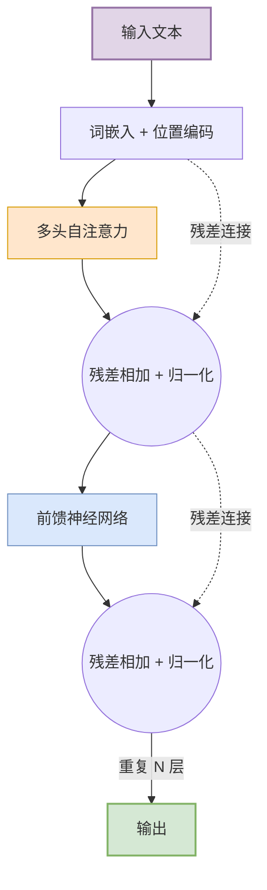

# 📖 附加阅读：Self-Attention 自注意力机制

> **关联章节**：第 2 章：第一次 LLM API 调用
> **阅读时间**：约 5 分钟

加一能看懂"它"指谁，靠的是 Transformer 模型里的自注意力（Self-Attention）：每个词都看一遍全句，按相关程度决定从谁那里取多少信息。

---

## 1. 它要解决的问题

例句："小明把书给了小红，因为她需要它。"要知道"它"指"书"，得同时看到整句话。

```cards
icon: 🐢
title: RNN 循环神经网络
what: 一个字一个字往后读
like: 主厨一个字一个字读订单，读到后面忘了前面
use: 句子一长，前文就忘了
color: orange

icon: 🔍
title: CNN 卷积神经网络
what: 每次透过小窗口看几个相邻词
like: 主厨每次只盯订单上相邻的几个字
use: 离得远的"它"和"书"连不上
color: blue

icon: 👀
title: Self-Attention 自注意力
what: 每个词直接和全句比较
like: 主厨读订单时，每个词都去看其他词
use: "它"一步就找到"书"
color: green
```

好比订单上写"不要辣"，"不要"会盯着"辣"，才知道自己否定的是什么。2017 年的论文《Attention Is All You Need》提出了 Transformer，核心就是自注意力。

<div data-anim="ch02-attention-links"></div>

*每个词把注意力分给全句，线越粗，分得越多。*

---

## 2. Query、Key、Value：每个词举两块牌子

```cards
icon: ❓
title: Query 查询
what: 我想找什么
like: 每个词举的牌子：我在找什么
use: "它"在问：我指的是谁？
color: purple

icon: 🏷️
title: Key 键
what: 我能提供什么
like: 每个词举的牌子：我是什么
use: "书"举牌：我是个物品
color: orange

icon: 📦
title: Value 值
what: 我携带的信息
like: 每个词实际携带的内容
use: "书"把自己的含义交出去
color: green
```

"Self" 指 Q、K、V 都来自同一个句子，句子自己查自己。

<div data-anim="ch02-qkv-steps"></div>

*打分、变百分比、按百分比混合 Value。*

---

## 3. 三条核心公式

```steps
title: 投影
desc: 每个词乘三个训练好的矩阵，得到 Q、K、V

title: 打分
desc: Q 和每个 K 做点积，方向越近分越高

title: Softmax
desc: 一行分数变成加起来等于 1 的百分比

title: 加权求和
desc: 按百分比把各词的 V 混在一起
```

设一个句子有 $N$ 个词，每个词是一串 $D$ 个数字（向量），排成矩阵 $X$：

$$
Q = X W_Q, \quad K = X W_K, \quad V = X W_V
$$

除以 $\sqrt{D}$ 是为了防止分数过大：

$$
A = \text{softmax}\left(\frac{Q K^T}{\sqrt{D}}\right)
$$

以"我 喜欢 AI"三个词为例，每个输出都混入了全句信息：

$$
Y = A V = \begin{bmatrix}
a_{00}v_0 + a_{01}v_1 + a_{02}v_2 \\\\
a_{10}v_0 + a_{11}v_1 + a_{12}v_2 \\\\
a_{20}v_0 + a_{21}v_1 + a_{22}v_2
\end{bmatrix}
$$

> **注意：** 混合比例随句子变，所以 "bank" 在 "river bank" 和 "bank account" 里含义不同。

---

## 4. 优点与代价

| 特性 | RNN | CNN | Self-Attention |
|------|-----|-----|----------------|
| 远处的词直接联系 | ❌ 容易忘 | ⚠️ 要堆很多层 | ✅ 一步直达 |
| 并行计算 | ❌ | ✅ | ✅ |
| 词序 | 天然有序 | 局部有序 | ⚠️ 要加位置编码 |

> **注意：** 每个词都和所有词比，计算量随句长的平方（$N^2$）增长。线性注意力、稀疏注意力等变体就是为了省这笔开销。

---

## 5. 它在 Transformer 里的位置

Transformer 就是主厨的大脑结构，由几十层这样的模块叠成：



```cards
icon: 🔤
title: 词嵌入 + 位置编码
what: 文字变向量，再补上词序
like: 给订单上每个字标好"第几个"
use: "我爱你"和"你爱我"能区分开

icon: 👥
title: 多头自注意力
what: 同时做几组注意力
like: 主厨同时从几个角度读单：忌口、份量、口味
use: 一组找"它"指谁，一组看动作

icon: ➕
title: 残差 + 归一化
what: 把输入加回输出，稳住数值
like: 调味时留着原汤打底
use: 让几十层的网络也训得动

icon: 🔧
title: 前馈神经网络
what: 对每个词的向量再加工一次
like: 每个词单独回锅再加工一次
use: 把注意力收集的信息揉进词义
```

---

## 6. 应用在哪里

```cards
icon: 🌍
title: 文字
what: 翻译、摘要、问答
like: 主厨读懂整张订单再动手
use: 加一读懂你的提问

icon: 🖼️
title: 图像
what: ViT 把图切块互相关注
like: 看摆盘照片时，每一块都对照别的块
use: Stable Diffusion 用文字控制画面

icon: 🔗
title: 多模态
what: 图像和文字的 token 放一起
like: 顾客拿菜品照片配文字点单
use: 给模型一张截图让它解释

icon: 🧬
title: 科学
what: 建模氨基酸之间的关系
like: 推算一根长面条会怎么盘起来
use: AlphaFold2 预测蛋白质结构
```

---

## 实践练习

```steps
icon: 🧮
title: 手算一遍
desc: 用 NumPy 随机生成 3 个词向量和三个权重矩阵，算出 A 和 Y，检查 A 每行之和是否为 1

icon: 📄
title: 读原论文
desc: 读《Attention Is All You Need》：它解决了什么问题？除了自注意力还提出了哪些概念？
```

---

## 延伸阅读

- [Attention Is All You Need（原始论文）](https://arxiv.org/abs/1706.03762)
- [The Illustrated Transformer（可视化讲解）](https://jalammar.github.io/illustrated-transformer/)
- [Transformer 论文逐段精读（中文视频）](https://www.bilibili.com/video/BV1pu411o7BE/)
- [自注意力机制的直觉理解（博客）](https://lilianweng.github.io/posts/2018-06-24-attention/)
- [多头注意力机制详解](https://d2l.ai/chapter_attention-mechanisms/multihead-attention.html)

---

**← 返回第 2 章：[加一睁开双眼 — 第一次 LLM API 调用](/ch02/)**
