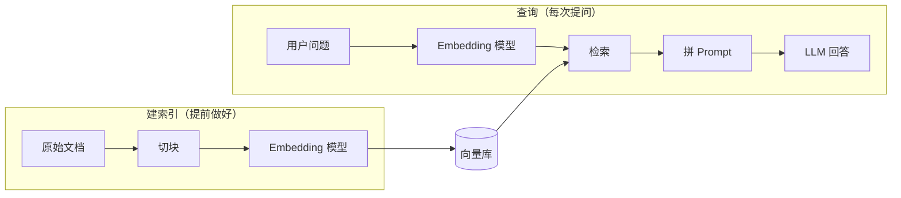

# 📚 第 3 章：加一学会读书 — RAG 从零到 Demo

## 故事：加一的菜谱库

用户问公司 2024 年的财报，加一编了一个像模像样的数字。PlutoKeating 给加一餐厅配了一个菜谱库：主厨先翻菜谱再做菜，不凭记忆瞎做。

```cards
icon: 🤥
title: 幻觉 Hallucination
what: 模型不知道答案，也照样编一个
like: 主厨没翻菜谱，凭印象报出店里没有的菜
use: 加一编出一个不存在的**财报数字**
color: red

icon: 📚
title: RAG 检索增强生成
what: 先找相关资料，再照着资料回答
like: 主厨先翻菜谱库再做菜，不凭记忆瞎做
use: 加一先翻公司文档，再回答财报问题
color: green
```

---

## RAG 的两条流水线

两条流水线靠同一个向量库连起来：



| 流水线 | 什么时候跑 | 做什么 |
|--------|-----------|--------|
| 建索引 | 提前跑一次，文档变了再跑 | 开业前把菜谱拆卡、标坐标、上柜 |
| 查询 | 每次用户提问 | 每来一单：取卡 → 递给主厨 → 出菜 |

### 建索引：开业前把菜谱上柜

<div data-anim="ch03-rag-indexing"></div>

*长文档切成小块，每块变成一串数字，连同原文一起存进向量库。*

```cards
icon: ✂️
title: 切块 Chunking
what: 长文档切成几百字的小块
like: 把厚菜谱拆成一张张菜谱卡
use: 公司手册切成块，每块讲一件事
color: orange

icon: 🗄️
title: 向量库 Vector Store
what: 存向量和原文，能快速找最像的
like: 按口味坐标摆放的菜谱柜，找相似的卡很快
use: 用 **FAISS** 或 **Chroma** 存手册的块
color: green
```

> **建议：** 相邻两块留一点重叠，免得句子被切成两半。

### 查询：先取菜谱卡，再做菜

<div data-anim="ch03-rag-query"></div>

*问题也变成向量，找最近的几块资料，和问题一起交给 LLM。*

```cards
icon: 🔍
title: 检索器 Retriever
what: 找离问题最近的 K 块资料
like: 按顾客的口味坐标，从柜里取最近的几张卡
use: 用户问财报，抽出最相关的 **2 块**
color: blue

icon: 📝
title: 拼 Prompt
what: 把资料和问题塞进一个模板
like: 把选出的菜谱卡和订单夹在一起递给主厨
use: 写明"**只根据资料回答，没有就说不知道**"
color: purple
```

```python
def 回答(问题):
    资料 = 向量库.找最近的(embedding模型.转换(问题), k=2)
    prompt = "只根据以下资料回答，没有就说不知道：\n" + 资料 + "\n问题：" + 问题
    return LLM.生成(prompt)
```

---

## 理解 Embedding：把文字变成坐标

<div data-anim="ch03-embedding-map"></div>

*口味坐标：辣菜聚在一片，甜品聚在另一片。检索就是取离顾客需求最近的几张卡。*

```cards
icon: 🗺️
title: Embedding 嵌入
what: 把一段文字变成一串数字
like: 给每张菜谱卡标上口味坐标
use: "麻婆豆腐"和"水煮鱼"的坐标挨得很近
color: blue

icon: 📏
title: 向量 Vector
what: 一串数字，代表文字的意思
like: 这串口味坐标，只是有几百个维度
use: `[0.12, 0.45, -0.33, …]`
color: purple
```

> **注意：** 两条流水线必须用**同一个 Embedding 模型**。用同一套口味坐标标出来的卡，才能比远近。

---

## 一个最小 Demo 的结构

一个网页，两个按钮，正好对应两条流水线：

```steps
icon: 📤
title: 上传 .txt 文档
desc: 触发建索引：切块 → Embedding → 存进 FAISS（放内存里）

icon: ⌨️
title: 输入问题
desc: 触发查询：Embedding → 找最近 2 块 → 拼 Prompt → LLM

icon: 👀
title: 页面同时显示资料和回答
desc: 答错时一眼看出是没查到，还是查到了没用好
```

> **建议：** 代码可以让 AI 按这个结构生成，常用 FAISS + Streamlit。

> **你的第二个产出：** 一个能上传文档、能检索、能基于知识库回答问题的 RAG Demo。

---

## RAG 优化方向（知道即可）

先跑通 Demo，再一项项优化：

```cards
icon: ✂️
title: 更好的切块
what: 按段落或语义边界切
like: 一道菜拆一张卡，不从做法中间剪断
use: 改的是建索引里的**切块**
color: orange

icon: 🔀
title: 混合检索
what: 关键词搜索（BM25）+ 语义搜索
like: 既按菜名找卡，也按口味坐标找卡
use: 用户问产品型号时，关键词更准
color: blue

icon: 🥇
title: 重排序 Rerank
what: 查完再用更细的模型排一次序
like: 先取一摞卡，再细看一遍，最合适的放最上面
use: 让排第一的资料更靠谱
color: green

icon: 📝
title: Prompt 优化
what: 指令写清楚，规定回答格式
like: 订单写清楚：做什么菜、怎么装盘
use: 要求加一回答时注明资料出处
color: purple

icon: 💬
title: 多轮对话
what: 检索时带上前面的聊天内容
like: 取卡前先翻这桌之前点过什么
use: 用户追问"那去年呢"，也能查对
color: red
```

> **注意：** 上下文太长时，模型容易忽略中间的内容（Lost in the Middle）。好比夹的卡太多，主厨只认真看了最上面和最下面几张。只放最相关的几块，效果通常比整本塞进去好。

---

## 🤖 向 AI 提问

> **理解 Embedding：** "请用一两句话加一个类比解释什么是 Embedding。我完全不懂数学。"

> **编写 RAG 代码：** "请按'建索引 + 查询'两条流水线，用 ChromaDB 做向量库，帮我写一个最小 RAG Demo。"

> **调试 RAG 效果：** "我的 RAG 系统检索出来的结果不相关，这是我的代码：[贴代码]。可能是什么原因？怎么改进？"

```text
角色：你是一个 RAG 系统架构师
任务：帮我设计一个 RAG 系统方案
上下文：我要处理 [文档类型，如 PDF 合同]，用户会问 [问题类型，如"合同金额是多少"]
要求：给出向量库、Embedding 模型、切块方式的选型建议
输出格式：先给架构图（文字描述），再给核心代码骨架，最后给预期效果
```

---

## 检查清单

- [ ] 说出 RAG 的两条流水线，以及它们靠向量库连起来
- [ ] 说出建索引的步骤：切块 → Embedding → 向量库
- [ ] 说出查询的步骤：Embedding → 检索 → 拼 Prompt → LLM
- [ ] 解释两条流水线为什么要用同一个 Embedding 模型
- [ ] 搭出一个能上传文档并提问的 RAG Demo
- [ ] 解释 RAG 为什么能减少幻觉

> **加一说：** "我有了自己的菜谱库，先翻菜谱再做菜，不会再瞎编了。可我只能动口，不能动手。发邮件、查天气、算数据，我都做不到。"

---

## 📚 本章参考资料

- [Pinecone — RAG 系列教程](https://www.pinecone.io/learn/series/rag/)
- [Pinecone — 文档分块策略详解](https://www.pinecone.io/learn/chunking-strategies/)
- [LangChain — RAG 教程](https://python.langchain.com/docs/tutorials/rag/)
- [LlamaIndex — RAG 核心概念](https://docs.llamaindex.ai/en/stable/understanding/rag/)
- [MTEB Leaderboard — Embedding 模型排行榜](https://huggingface.co/spaces/mteb/leaderboard)
- [Ragas — RAG 系统评估框架](https://docs.ragas.io/)
- [论文：Lost in the Middle — 长上下文中的检索问题](https://arxiv.org/abs/2307.03172)

---

**← 上一章：[第 2 章：加一睁开双眼 — 第一次 LLM API 调用](/ch02/)**  
**→ 下一章：[第 4 章：加一学会动手 — Agent 核心循环](/ch04/)**
