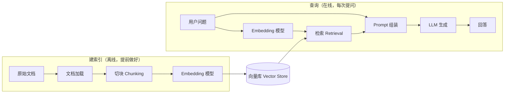

# 📚 第 3 章：加一学会读书 — RAG 从零到 Demo

## 故事：加一的图书馆

用户问"我们公司 2024 年的财报数据是多少"，加一答出一个看似专业、实为虚构的数字。这种现象叫 **幻觉（Hallucination）**：模型没有你的私有资料，遇到不知道的事也会照样生成答案。PlutoKeating 决定给加一建一座图书馆，让它先查资料再回答，考试从闭卷变成开卷。

这座图书馆就是 **RAG（Retrieval-Augmented Generation，检索增强生成）**：先检索相关文档，再让模型基于这些文档生成回答。

---

## RAG 的两条流水线

RAG 系统由两条流水线组成，它们在不同时间运行，通过同一个向量库连接。

- **建索引流水线**：提前运行一次（文档更新时再运行），把文档整理成可检索的形式。
- **查询流水线**：每次用户提问时运行，找资料并生成回答。



两条流水线必须使用**同一个 Embedding 模型**。文档和问题被转换到同一个坐标系里，才能比较远近。

### 建索引流水线的组件

| 步骤 | 组件 | 输入 → 输出 | 负责什么 |
|------|------|------------|---------|
| 1 | 文档加载器 | 文件（txt、PDF、网页）→ 纯文本 | 读取文件，抽出文字 |
| 2 | 切块器（Chunker） | 长文本 → 若干文本块 | 把长文档切成几百字的小块，相邻块保留少量重叠，避免句子被切断后丢失上下文 |
| 3 | Embedding 模型 | 文本块 → 向量 | 把每个块转换成一串数字 |
| 4 | 向量库 | 向量 + 原文块 → 索引 | 保存向量和对应原文，支持"找最相近的几个"这种查询，常见实现有 FAISS、Chroma |

### 查询流水线的组件

| 步骤 | 组件 | 输入 → 输出 | 负责什么 |
|------|------|------------|---------|
| 1 | Embedding 模型 | 用户问题 → 问题向量 | 与建索引时是同一个模型 |
| 2 | 检索器（Retriever） | 问题向量 → 最相关的 K 个文本块 | 在向量库里找距离最近的块，K 通常取 2–5 |
| 3 | Prompt 组装 | 问题 + 文本块 → 完整 Prompt | 把资料和问题拼进模板，并要求模型"只根据资料回答，资料里没有就说没有" |
| 4 | LLM | Prompt → 回答 | 阅读资料，生成最终回答 |

查询流水线写成伪代码只有几行：

```python
def 回答(问题):
    问题向量 = embedding模型.转换(问题)
    资料 = 向量库.找最近的(问题向量, k=2)
    prompt = "只根据以下资料回答，资料里没有就说不知道：\n" + 资料 + "\n问题：" + 问题
    return LLM.生成(prompt)
```

---

## 理解 Embedding：把文字变成坐标

Embedding（嵌入）把一段文字转换成一串数字（向量），语义相近的文字得到的向量也相近。

```text
"苹果很好吃"  →  [0.12, 0.45, -0.33, 0.78, ...]   ┐ 距离近（都在说水果）
"香蕉很不错"  →  [0.15, 0.42, -0.30, 0.75, ...]   ┘
"汽车跑得快"  →  [0.89, -0.12, 0.56, -0.44, ...]    距离远（话题无关）
```

可以把它想成地图坐标：水果类的句子聚在一个区域，交通工具类的句子在另一个区域。检索器做的事，就是在地图上找离问题最近的那几个点。

---

## 一个最小 Demo 的结构

本章的 Demo 是一个网页：上传文档，然后提问。它的两个界面动作正好对应两条流水线。

```text
[上传 .txt 按钮] ──→ 建索引流水线：读取 → 切块 → Embedding → 存入向量库（FAISS，放在内存里）
                                                                    │
[输入问题框]    ──→ 查询流水线：  Embedding → 检索 Top-2 ←──────────┘
                                   → 组装 Prompt → LLM → 显示"检索到的资料"和"加一的回答"
```

页面同时展示检索到的资料和最终回答，方便你判断答错时是"没检索到"还是"检索到了但模型没用好"。具体代码可以让 AI 按上面的结构帮你生成，常用组合是 FAISS 做向量库、Streamlit 做网页界面。

> **你的第二个产出：** 一个能上传文档、能检索、能基于知识库回答问题的 RAG Demo。

---

## RAG 优化方向（知道即可）

| 优化方向 | 怎么做 | 改进的是哪一环 | 效果 |
|---------|-------|--------------|------|
| 更好的切块 | 按段落或语义边界切块 | 建索引：切块器 | 提高召回质量 |
| 混合检索 | 关键词搜索（BM25）与语义搜索结合 | 查询：检索器 | 召回更全面 |
| 重排序（Rerank） | 检索后用更精细的模型重新排序 | 查询：检索器之后 | 排在前面的结果更准 |
| Prompt 优化 | 指令更清晰，指定回答格式 | 查询：Prompt 组装 | 回答更规范 |
| 多轮对话中的 RAG | 检索时带上对话上下文 | 查询：Embedding 之前 | 体验更连贯 |

先把 Demo 跑通，再逐项优化。

> **"Lost in the Middle" 现象：** 上下文过长时，模型容易忽略中间位置的信息，更关注开头和结尾。所以只检索最相关的几段放进 Prompt，效果通常好过把全部文档塞进去。

---

## 🤖 向 AI 提问

> **理解 Embedding：** "请用一两句话加一个类比解释什么是 Embedding。我完全不懂数学。"

> **编写 RAG 代码：** "请按'建索引 + 查询'两条流水线，用 ChromaDB 做向量库，帮我写一个最小 RAG Demo。"

> **调试 RAG 效果：** "我的 RAG 系统检索出来的结果不相关，这是我的代码：[贴代码]。可能是什么原因？怎么改进？"

Prompt 模板：

```text
角色：你是一个 RAG 系统架构师
任务：帮我设计一个 RAG 系统设计方案
上下文：我需要处理 [文档类型，如 PDF 合同]，用户会问 [问题类型，如"合同金额是多少"]
要求：给出技术选型建议（向量库、Embedding 模型、切块策略）
输出格式：先给架构图（文字描述），再给核心代码骨架，最后给出预期效果
```

---

## 检查清单

完成本章后，你应该能：

- [ ] 说出 RAG 的两条流水线，以及它们通过向量库连接
- [ ] 列出建索引的组件：文档加载 → 切块 → Embedding → 向量库
- [ ] 列出查询的组件：Embedding → 检索 → Prompt 组装 → LLM 生成
- [ ] 解释两条流水线为什么要用同一个 Embedding 模型
- [ ] 搭出一个能上传文档并提问的 RAG Demo
- [ ] 解释 RAG 为什么能减少幻觉

> **加一说：** "我有了自己的图书馆，查完资料再回答，不会再瞎编了。可我只能动口，不能动手。用户想让我发邮件、查天气、算数据，我都做不到。"

---

## 📚 本章参考资料

- [Pinecone — RAG 系列教程](https://www.pinecone.io/learn/series/rag/)
- [Pinecone — 文档分块策略详解](https://www.pinecone.io/learn/chunking-strategies/)
- [LangChain — RAG 教程](https://python.langchain.com/docs/tutorials/rag/)
- [LlamaIndex — RAG 核心概念](https://docs.llamaindex.ai/en/stable/understanding/rag/)
- [MTEB Leaderboard — Embedding 模型排行榜](https://huggingface.co/spaces/mteb/leaderboard)
- [Ragas — RAG 系统评估框架](https://docs.ragas.io/)
- [论文：Lost in the Middle — 长上下文中的检索问题](https://arxiv.org/abs/2307.03172)

---

**← 上一章：[第 2 章：加一睁开双眼 — 第一次 LLM API 调用](/ch02/)**  
**→ 下一章：[第 4 章：加一学会动手 — Agent 核心循环](/ch04/)**
