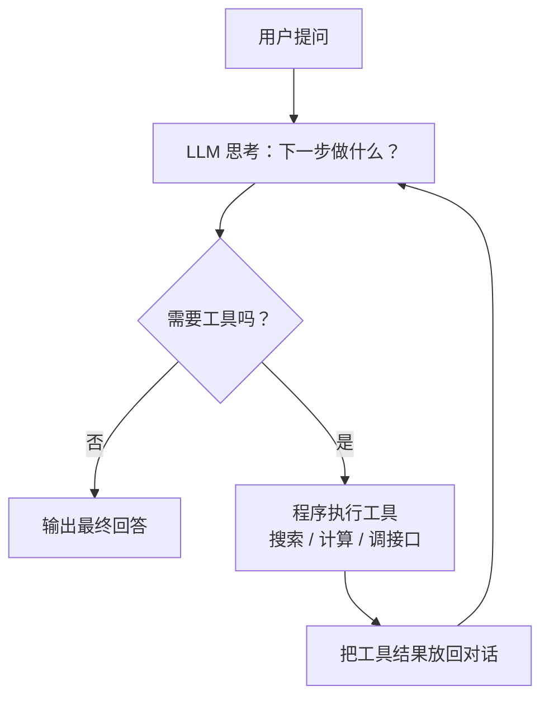

# 🖐️ 第 4 章：加一学会动手 — Agent 核心循环

## 故事：从"说话"到"做事"

加一能聊天，也能查资料了。可用户让它"查今天的天气""算这个月的销售额""给张三发封邮件"，它只能回一句"抱歉，我只能提供文字回答"。PlutoKeating 决定给加一装上"双手"：让它能调用外部功能去做事。能做事的 AI，就叫 **Agent（智能体）**。

---

## Agent 由哪几块组成

```text
Agent = Chatbot + Tools + Loop
```

| 组件 | 含义 | 在加一身上 |
|------|------|-----------|
| Chatbot | 能对话的大语言模型（LLM） | 大脑：负责思考和决定 |
| Tools | 模型可以请求调用的外部功能，如搜索、计算、发邮件 | 双手：负责执行 |
| Loop | 思考 → 行动 → 观察结果 → 再思考，反复进行 | 把大脑和双手串起来 |

Agent 的核心在于这个循环，用哪个框架都可以。

---

## 循环架构



这种"推理一步、行动一步"交替进行的模式叫 **ReAct**（Reasoning + Acting，推理 + 行动）。

每一块的职责：

| 部分 | 谁来做 | 负责什么 |
|------|--------|----------|
| 思考 | LLM | 读对话记录，决定直接回答还是调用哪个工具、传什么参数 |
| 执行 | 你的程序 | 按 LLM 给出的工具名和参数，去调接口、查数据库 |
| 观察 | 你的程序 | 把工具返回的结果追加到对话记录里，交回给 LLM |
| 对话记录 | 程序维护的消息列表 | 保存用户问题、LLM 的每次决定、每次工具结果，是循环里流动的数据 |

---

## Function Calling：四步交互

Function Calling（函数调用）是让 LLM "用上工具"的机制。整个过程分四步：

```text
① 程序 → LLM ：发送用户问题 + 工具清单（每个工具的名字、用途说明、参数说明）
② LLM → 程序 ：返回一个调用请求，例如 { 工具: get_weather, 参数: { city: "北京" } }
③ 程序        ：在本地执行 get_weather("北京")，得到 "晴，25°C"
④ 程序 → LLM ：把 "晴，25°C" 发回去，LLM 据此继续思考，或直接写出回答
```

LLM 自己不运行任何代码。它只输出"该调哪个工具、传什么参数"，执行工具的是你的程序。第 ④ 步之后如果 LLM 又发出调用请求，就回到第 ② 步，这就是上面那张图里的循环。

---

## 循环伪代码

```python
对话记录 = [用户问题]
for 第几步 in range(最多步数):
    回复 = LLM(对话记录, 工具清单)
    if 回复 是 最终回答:
        return 回复
    for 调用 in 回复.工具调用列表:
        try:
            结果 = 执行工具(调用.工具名, 调用.参数)
        except 出错 as 错误:
            结果 = "工具出错：" + 错误
        对话记录.追加(调用, 结果)
return "步数用完，请简化问题后重试"
```

这里有两处保护：`最多步数` 防止 Agent 无限循环；`try` 让工具失败时把错误信息交给 LLM 处理，程序不会直接崩溃。

---

## 设计 Agent 的四条原则

| 原则 | 做法 | 例子 |
|------|------|------|
| 工具要小 | 一个工具只做一件事 | 拆成 `search_web`、`send_email`、`calculate`，不要做一个万能的 `do_everything` |
| 描述要清楚 | LLM 靠工具描述选工具，描述越具体越容易选对 | "搜索" 太模糊；"搜索互联网获取最新信息，适用于查新闻、实时数据" 更好 |
| 限制步数 | 给循环设上限 | 最多 5 步，超过就停止并提示用户 |
| 处理失败 | 网络超时、接口报错、参数不合法都要接住 | 把错误作为工具结果交回 LLM |

> **Anthropic 的建议：** 最有效的 Agent 往往结构最简单。先从单次 LLM 调用开始，确认需要时再逐步加入工具、多 Agent 等复杂度。设计过度的 Agent 难维护，行为也更难预测。

---

## 🤖 向 AI 提问

### 设计工具

> **向 AI 提问：** "我想给我的 Agent 添加一个搜索网页的工具。请帮我设计工具的接口、参数和实现代码。"

### 理解 Agent 循环

> **向 AI 提问：** "请用伪代码解释 ReAct 模式的 Agent 循环，帮我理清 reasoning 和 acting 是怎么交替进行的。"

### 调试 Tool Calling

> **向 AI 提问：** "我的工具调用没有触发，LLM 直接回答了而没有调用工具。这是我的工具定义：[贴代码]。可能是什么原因？"

### Prompt 模板

```text
角色：你是一个 Agent 系统开发者
任务：帮我设计一个 [场景] 场景下的 Agent 工具集
场景：例如"一个客服 Agent，需要查询订单、退货、物流信息"
要求：给出每个工具的 name, description, parameters（JSON Schema 格式）
输出格式：按优先级排序的工具列表，附带选择理由
```

---

## 检查清单

完成本章后，你应该能：

- [ ] 用自己的话解释 Agent = Chatbot + Tools + Loop
- [ ] 画出 ReAct 循环：思考 → 调用工具 → 观察结果 → 再思考
- [ ] 说清 Function Calling 的四步交互，以及哪一步由 LLM 做、哪一步由程序做
- [ ] 说出设计工具的四条原则

---

## 📚 参考资料

- [Lilian Weng's Agent Blog](https://lilianweng.github.io/posts/2023-06-23-agent/) — Agent 领域的经典参考，梳理了规划、记忆、工具使用等核心概念
- [ReAct Prompting](https://www.promptingguide.ai/techniques/react) — ReAct（推理 + 行动）模式指南
- [Anthropic: Building Effective Agents](https://www.anthropic.com/engineering/building-effective-agents) — Anthropic 团队构建 Agent 的实践经验
- [OpenAI Function Calling Docs](https://platform.openai.com/docs/guides/function-calling) — OpenAI 官方 Function Calling 文档
- [LangChain Agent Concepts](https://python.langchain.com/docs/concepts/agents/) — LangChain 框架中的 Agent 概念与用法

> **加一说：** "我现在会做事了。可工具越来越多，每个接入方式都不一样；而且跟用户聊完就忘。我需要一套工具箱规范和一个记忆系统。"

---

**← 上一章：[第 3 章：加一学会读书 — RAG 从零到 Demo](/ch03/)**  
**→ 下一章：[第 5 章：加一的工具箱与记忆库 — Tool, MCP, Memory](/ch05/)**
