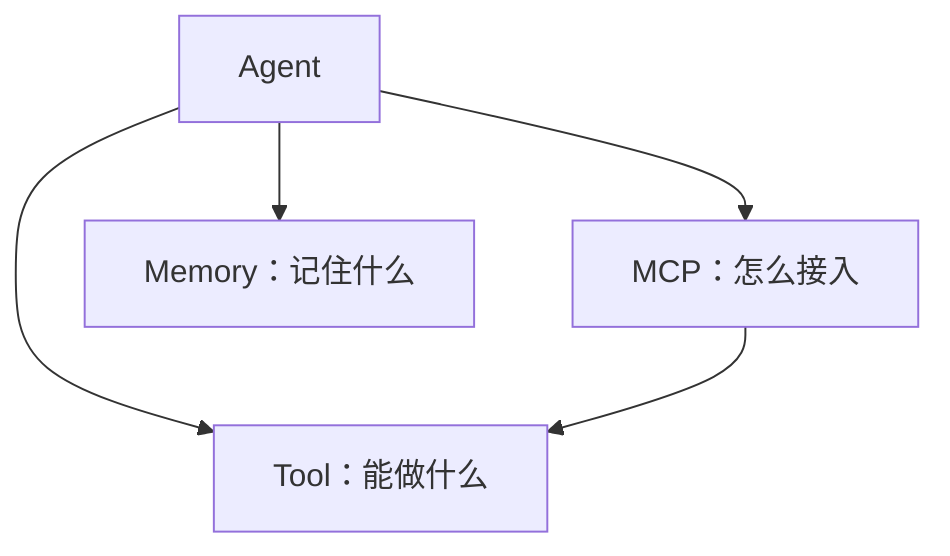

# 🧰 第 5 章：加一的工具箱与记忆库 — Tool, MCP, Memory

## 故事：工具箱与记忆库

加一的工具越来越多，每个接法都不一样，加一个就要写一堆接入代码。
它还记性差：用户说"刚才查了北京，再查一下上海"，它不知道"刚才"指什么。

```cards
icon: 🔧
title: Tool 工具
what: 模型能调用的一个函数
like: 像厨房设备和供应商：烤箱、秤、菜市场
use: 加一用 `get_weather` 查天气
color: orange

icon: 📋
title: MCP 协议
what: 工具接入的统一规矩
like: 像统一供货标准，各家用同一种送货单
use: 加一换个应用，工具照样能用
color: green

icon: 🧠
title: Memory 记忆
what: 决定模型每次能看到哪些旧对话
like: 像出餐台订单夹加老顾客档案本
use: 加一记住用户**叫小王、爱吃辣**
color: purple
```

---

## 第 1 部分：Tool — 墙上的设备说明牌

模型看不到函数内部，只读名字、说明和参数。
好比主厨不拆烤箱，只看墙上的设备说明牌。
一个工具只做一件事：查航班就只查航班。

```cards
icon: 🏷️
title: 名字有含义
what: 看名字就知道它干什么
like: 说明牌写"烤箱"，主厨一看就懂
use: `search_flights` 好过 `tool1`
color: blue

icon: 📐
title: 参数写清格式
what: 每个参数标明类型和写法
like: 领料单写明数量单位："鸡蛋 3 个"
use: 出发日期写成 `YYYY-MM-DD`
color: blue

icon: 📖
title: 说明写清楚
what: 做什么、要什么、返回什么
like: 说明牌写清：能干什么、要放什么
use: "按城市查今天天气，返回温度"
color: green

icon: 🩹
title: 出错返回文字
what: 报错时返回提示文字，程序不崩
like: 仓库没货也回话"没货"，主厨换食材
use: 返回"城市名无效"，模型换参数重试
color: red
```

---

## 第 2 部分：MCP — 统一的供货标准

**MCP（Model Context Protocol，模型上下文协议）**：Anthropic 提出的开放协议，规定 AI 应用怎样发现和调用外部工具。OpenAI、Google 等厂商也已支持。
好比餐厅定下统一供货标准：每家供应商都用同一种送货单，后厨不用为每家改流程。

```cards
icon: 🏠
title: Host 宿主
what: 用户直接用的 AI 应用
like: 像餐厅本身
use: 加一所在的聊天客户端
color: blue

icon: 🔗
title: Client 客户端
what: Host 里负责和 Server 通话的模块
like: 像专门对接某一家供应商的采购员
use: 加一里专连"天气 Server"的那一路
color: purple

icon: 🧩
title: Server 服务端
what: 按 MCP 格式提供一组工具
like: 像供应商，按标准送货
use: 天气 Server 提供 `get_weather`
color: green
```

<div data-anim="ch05-mcp-flow"></div>

```steps
icon: 🔍
title: 发现
desc: Agent 问 Server：你有哪些工具？

icon: 🤔
title: 选择
desc: 模型看工具清单，挑一个、填好参数

icon: ⚙️
title: 调用
desc: Server 执行工具，把结果交回 Agent
```

> **建议：** 新增工具只在 Server 注册一次，Agent 端代码不用改。

---

## 第 3 部分：Memory — 让 AI 记住事情

模型本身不存对话，每次都要把聊天记录一起发过去。
好比主厨记不住这桌点过什么，服务员每次把订单记录一起递进去。
能发的量有上限，叫**上下文窗口**（模型一次能读的最大文字量），像出餐台上的订单夹，只夹得下几张。

<div data-anim="ch05-context-window"></div>

*订单夹满了，新单进来旧单被挤掉，模型就忘了。*

```cards
icon: 📝
title: 短期记忆
what: 只留最近 N 轮，更早的丢掉
like: 像订单夹，新单进来，最旧那张被挤掉
use: 用户问"那上海呢"，加一看得到上一轮
color: blue

icon: 📒
title: 长期记忆
what: 旧对话的要点存到外面，用时取回
like: 像老顾客档案本：爱吃辣、忌口
use: 下次聊天，加一还记得用户爱吃辣
color: green

icon: 🧭
title: 记忆检索
what: 按意思相近程度找出相关要点
like: 按口味坐标翻档案本，只取相关几条
use: 问"晚饭吃啥"，找出"爱吃辣"
color: purple
```

<div data-anim="ch05-memory-recall"></div>

*长期记忆像老顾客档案本：要点记下来，用时翻出相关几条。检索方法和第 3 章 RAG 相同。*

---

## 三者的关系



---

## 🤖 向 AI 提问

> **向 AI 提问：** "请用简单的话解释 MCP 协议是什么，它在 Agent 架构中解决什么问题？我刚开始学习 Agent 开发。"

> **向 AI 提问：** "我想给一个客服 Agent 设计记忆系统，需要长期记忆和短期记忆结合。请给出架构设计思路。"

```text
角色：你是一个 AI 系统架构师
任务：帮我设计 [场景] 场景下的工具和记忆方案
场景描述：[描述你的应用场景]
要求：
1. 列出至少 5 个工具，每个工具包含 name, description, parameters
2. 设计记忆策略（短期记忆保留几轮？长期记忆如何总结和检索？）
输出格式：先给表格，再给设计说明
```

---

## 检查清单

- [ ] 说出一个好工具要写清楚哪几项
- [ ] 说出 MCP 的三个角色和"发现 → 选择 → 调用"
- [ ] 说出短期记忆和长期记忆的区别

---

## 📚 参考资料

- [MCP 官方网站](https://modelcontextprotocol.io/) — 入门指南和文档
- [MCP 规范](https://spec.modelcontextprotocol.io/) — 协议完整规范
- [Anthropic MCP 公告](https://www.anthropic.com/news/model-context-protocol) — 发布 MCP 的官方公告
- [MCP GitHub](https://github.com/modelcontextprotocol) — 开源仓库，含 SDK 和示例
- [LangGraph Memory Concepts](https://langchain-ai.github.io/langgraph/concepts/memory/) — LangGraph 的记忆机制概念
- [LangChain Tool Concepts](https://python.langchain.com/docs/concepts/tools/) — LangChain 的工具概念

> **加一说：** "我的工具箱整齐了，记忆系统也装上了。可有些任务太复杂，我一个人忙不过来……也许我需要几个小伙伴来帮忙。"

---

**← 上一章：[第 4 章：加一学会动手 — Agent 核心循环](/ch04/)**  
**→ 下一章：[第 6 章：加一的团队 — Multi-Agent 何时用](/ch06/)**
