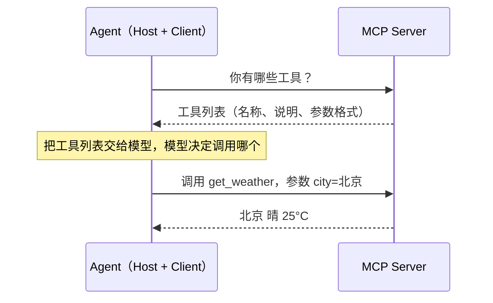
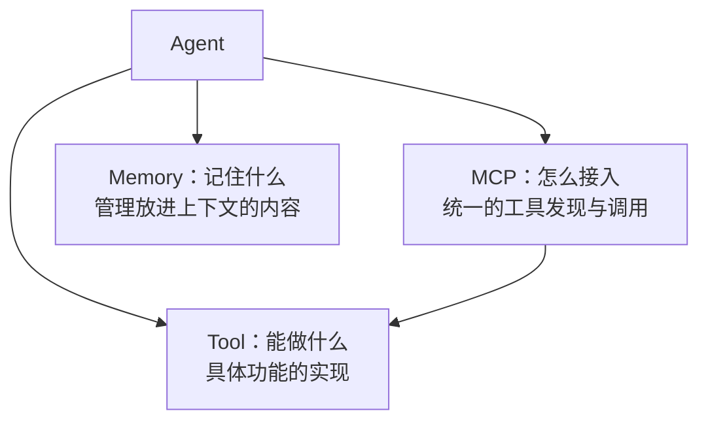

# 🧰 第 5 章：加一的工具箱与记忆库 — Tool, MCP, Memory

## 故事：工具箱与记忆库

加一会调用工具以后，PlutoKeating 发现它的工具箱很乱：天气工具是本地函数，搜索工具走 Web API，发邮件要用公司内部 SDK，每加一个工具都要写一堆接入代码。更麻烦的是加一记不住事：用户说"刚才查了北京，再查一下上海"，加一完全不知道"刚才"指什么。

本章解决两件事：

| 问题 | 对应方案 |
|------|---------|
| 工具接入方式五花八门 | Tool 设计规范 + MCP 协议 |
| 对话一长就忘 | Memory（记忆）机制 |

---

## 第 1 部分：Tool — 工具设计原则

工具就是一个让模型调用的函数。模型看不到函数内部，只能读到它的名字、说明和参数，所以这三样要写清楚。

一个工具只做一件事。比如"查航班"工具只负责按出发地、目的地、日期查航班，不顺带订票或查天气。

| 要求 | 原因 |
|------|------|
| 名字和参数名有含义（如 `search_flights`、`departure`） | 模型靠名字判断该不该用、参数填什么 |
| 每个参数标明类型和格式（如日期写 `YYYY-MM-DD`） | 模型按格式填参数，少出错 |
| 写清说明：做什么、每个参数的含义、返回什么 | 这段说明就是给模型看的使用手册 |
| 出错时返回一段错误文字，不让程序崩溃 | 模型读到错误后可以换个参数重试 |

---

## 第 2 部分：MCP — 统一的工具接入方式

**MCP（Model Context Protocol，模型上下文协议）** 是 Anthropic 提出的开放协议，规定 AI 应用怎样发现和调用外部工具。可以把它类比成 USB-C：以前每个工具像一种不同的充电口，MCP 定下一个统一接口，工具按这个接口提供一次，各个支持 MCP 的 Agent 都能直接用。目前 OpenAI、Google 等厂商和许多工具提供商也已支持 MCP。

### 组成

| 角色 | 负责什么 |
|------|---------|
| Host（宿主应用） | 用户直接使用的 AI 应用，比如一个聊天客户端或 Agent 程序 |
| Client（客户端） | Host 内部负责和某个 MCP Server 通信的模块 |
| Server（服务端） | 把一组工具（以及数据、提示模板）按 MCP 格式提供出来 |

### 数据怎么流动



1. **发现**：Agent 向 Server 要工具列表。
2. **选择**：Agent 把列表交给模型，模型决定调用哪个工具、填什么参数。
3. **调用**：Agent 把调用请求发给 Server，Server 执行后返回结果。

Server 内部只需要两个能力：

```text
列出工具()        → 返回每个工具的 名称 / 说明 / 参数格式
调用工具(名称, 参数) → 找到对应函数并执行；找不到就返回"未知工具"
```

新增工具时只在 Server 里注册一次，Agent 端的代码不用改。

---

## 第 3 部分：Memory — 让 AI 记住事情

模型本身不保存对话。每次请求时，程序要把之前的对话一起发给模型，模型才"记得"。能发进去的内容有上限，这个上限叫**上下文窗口**（模型一次能读入的最大文字量）。对话一长就装不下，最早的内容只能丢掉。Memory 机制决定保留什么、怎么保留。

```text
用户：帮我查一下北京的天气。
加一：北京今天晴，25°C。
用户：那上海呢？        ← "那"指天气，加一必须看到上一轮才能理解
```

### 短期记忆与长期记忆

| 类型 | 做法 | 适合场景 |
|------|------|---------|
| 短期记忆 | 只保留最近 N 轮对话，更早的自动丢弃（滑动窗口） | 当前这段对话的上下文 |
| 长期记忆 | 定期把历史对话总结成摘要存起来，需要时按相关度取回 | 跨很多轮或跨会话的信息，如用户姓名、偏好 |

### 一次带记忆的对话流程

```text
用户输入
   │
   ▼
存入短期记忆（最近 N 轮，超出的最早几条被挤掉）
   │
   ▼
按用户问题去长期记忆库检索相关摘要
   │
   ▼
拼成请求：系统提示 + 相关摘要 + 最近 N 轮对话 + 本次问题
   │
   ▼
发给模型 → 得到回复 → 回复也存入短期记忆
   │
   ▼
每隔 N 轮：让模型把这几轮对话总结成摘要 → 存入长期记忆库
```

长期记忆的"按相关度取回"通常用向量检索：把摘要和问题都转成一串数字（向量），数字越接近表示意思越相近，取最接近的几条。这和第 3 章 RAG 的检索方法相同。

---

## Tool、MCP、Memory 的关系



Tool 提供具体功能，MCP 把这些功能用统一格式交给 Agent，Memory 决定每次请求时模型能看到哪些历史信息。

---

## 🤖 向 AI 提问

> **向 AI 提问：** "请用简单的话解释 MCP 协议是什么，它在 Agent 架构中解决什么问题？我刚开始学习 Agent 开发。"

> **向 AI 提问：** "我想给一个客服 Agent 设计记忆系统，需要长期记忆和短期记忆结合。请给出架构设计思路。"

```text
角色：你是一个 AI 系统架构师
任务：帮我设计 [场景] 场景下的工具和记忆方案
场景描述：[描述你的应用场景]
要求：
1. 列出至少 5 个工具，每个工具包含 name, description, parameters
2. 设计记忆策略（短期记忆保留几轮？长期记忆如何总结和检索？）
输出格式：先给表格，再给设计说明
```

---

## 检查清单

完成本章后，你应该能：

- [ ] 说出一个好工具要写清楚的几项内容
- [ ] 说出 MCP 的三个角色和"发现 → 选择 → 调用"流程
- [ ] 说出短期记忆和长期记忆的区别
- [ ] 画出一次带记忆的对话中，数据经过哪些步骤

---

## 📚 参考资料

- [MCP 官方网站](https://modelcontextprotocol.io/) — Model Context Protocol 官方站点，包含入门指南和文档
- [MCP 规范](https://spec.modelcontextprotocol.io/) — MCP 协议完整规范文档
- [Anthropic MCP 公告](https://www.anthropic.com/news/model-context-protocol) — Anthropic 发布 MCP 的官方公告
- [MCP GitHub](https://github.com/modelcontextprotocol) — MCP 开源仓库，包含 SDK 和示例
- [LangGraph Memory Concepts](https://langchain-ai.github.io/langgraph/concepts/memory/) — LangGraph 框架中的记忆机制概念
- [LangChain Tool Concepts](https://python.langchain.com/docs/concepts/tools/) — LangChain 框架中的工具概念与用法

> **加一说：** "我的工具箱整齐了，记忆系统也装上了。可有些任务太复杂，我一个人忙不过来……也许我需要几个小伙伴来帮忙。"

---

**← 上一章：[第 4 章：加一学会动手 — Agent 核心循环](/ch04/)**  
**→ 下一章：[第 6 章：加一的团队 — Multi-Agent 何时用](/ch06/)**
