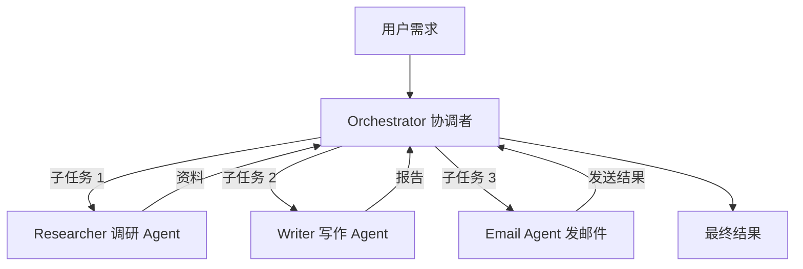

# 👥 第 6 章：加一的团队 — Multi-Agent 何时用

## 故事：一个人忙不过来了

用户让加一"调研竞争对手的产品动态，写成报告，再发邮件给全组"。这件事要搜索、读文章、写报告、查邮箱列表、发邮件，一共五步，中间切换好几种工具，上下文越堆越乱，一步出错整条流程就断。PlutoKeating 决定给加一组建一个团队。

**Multi-Agent（多智能体系统）**：把一个大任务交给几个 Agent 分工完成，每个 Agent 只负责一件事，由一个协调者把它们串起来。

---

## 系统由哪几块组成



| 模块 | 负责什么 | 输入 | 输出 |
|------|----------|------|------|
| Orchestrator（协调者） | 拆分任务、分派、汇总 | 用户需求 | 最终答复 |
| Worker（工作者 Agent） | 完成一个子任务，带自己的提示词和工具 | 协调者给的子任务 | 子任务结果 |
| 各自的上下文 | 每个 Agent 单独保存对话记录 | — | — |

每个 Worker 本质上就是前几章做的单 Agent：一个 LLM，加一段角色提示词，加几样工具。

---

## 什么时候需要多 Agent

| 场景 | 单 Agent | 多 Agent |
|------|----------|----------|
| 简单问答 | 够用 | 不需要 |
| 调一个工具（查天气） | 够用 | 不需要 |
| 多步骤，流程固定 | 可以，提示词会变复杂 | 分开写更清楚 |
| 需要几种不同角色或专业知识 | 难兼顾 | 推荐 |
| 复杂协作流程 | 难维护 | 推荐 |

按下面四个问题判断，有一项回答"是"再考虑多 Agent：

1. 任务需要几个不同的角色吗？（搜索、编程、审核各一个）
2. 需要不同的专业知识吗？
3. 有子任务可以同时跑吗？（同时查天气、新闻、股票）
4. 单个 Agent 的上下文经常被塞满、搞乱吗？

---

## 三种常见协作模式

| 模式 | 数据怎么流动 | 适合 |
|------|--------------|------|
| Orchestrator-Worker（协调者-工作者） | 协调者拆任务 → 多个 Worker 各做一块 → 协调者汇总 | 能拆成几个独立子任务的大任务 |
| Pipeline（流水线） | A 处理输入 → B 分析 → C 整理输出，前一个的输出是后一个的输入 | 步骤有严格先后顺序 |
| Debate（辩论） | A、B 各给一个答案 → 评判 Agent 比较后选出结果 | 需要多角度评估，如代码审查、内容审核 |

---

## 一个三 Agent 的流程示例

"调研 → 写报告 → 质检"的协调者逻辑，用伪代码表示：

```text
函数 协调者(主题, 要求):
    资料 = 调研Agent(主题)              # 搜索并返回原始信息
    报告 = 写作Agent(资料, 要求)        # 提示词：把零散信息整理成带标题和要点的报告
    评审 = 质检Agent(报告)              # 提示词：按结构、准确性、可读性打分并提建议
    如果 评审分数 太低:
        报告 = 写作Agent(资料, 要求 + 评审意见)
    返回 报告
```

三个 Agent 各有一段独立的系统提示词，彼此只通过协调者传递"资料"和"报告"这两份数据，看不到对方的对话记录。

---

## 多 Agent 的四个陷阱

| 陷阱 | 表现 | 对策 |
|------|------|------|
| 过度设计 | 用户问"几点了"，启动 5 个 Agent | 单 Agent 能解决就用单 Agent |
| 互相干扰 | 共用一份上下文，A 的中间结果干扰 B 的推理 | 每个 Agent 用独立上下文 |
| 错误传播 | A 出错，B 接着错，最终结果完全偏离 | 每一步校验输入输出，关键节点加人工审核 |
| 成本上涨 | 每多一个 Agent 就多几次 LLM 调用，Token 消耗成倍增加 | 先估算每个 Agent 带来的额外成本 |

---

## 新手的顺序

Anthropic 在 Agent 构建指南里提到：很多成功的部署用的都是简单的单 Agent 架构，复杂度应该在实际失败证明有必要时再加。如果单 Agent 已经能稳定完成大部分任务，先找出当前系统的瓶颈，再判断拆分是否是最简单的解法。

1. ✅ 单 Agent + 简单工具
2. ✅ 单 Agent + 复杂工具 + 好的 Memory
3. ✅ 单 Agent 稳定运行
4. ⬜ 判断是否需要多 Agent
5. ⬜ 从 Orchestrator-Worker 模式开始尝试

---

## 🤖 向 AI 提问

> **判断是否需要：** "我的场景是 [描述场景]。这个场景该用多 Agent 还是单 Agent？说明理由。"

> **设计架构：** "请为 [场景] 设计一个多 Agent 系统：需要哪些 Agent，各自负责什么，数据怎么在它们之间传递，画出架构图。"

```
角色：多 Agent 系统架构师
任务：评审我的多 Agent 设计方案
我的方案：[描述你的设计]
评审维度：
1. 每个 Agent 的职责边界是否清晰
2. 是否过度设计（单 Agent 能否解决）
3. 错误传播风险
4. Token 成本
```

---

## 检查清单

- [ ] 能判断一个场景该用单 Agent 还是多 Agent
- [ ] 能说出 Orchestrator-Worker、Pipeline、Debate 三种模式的数据流向
- [ ] 能画出一个三 Agent 协作系统的模块图
- [ ] 知道四个常见陷阱和对策
- [ ] 知道从单 Agent 到多 Agent 的演进顺序

> **加一说：** "从只会复读到能带团队，我长大了很多。下一步该用实际项目检验一下了。"

---

## 📚 参考资料

- https://www.anthropic.com/engineering/building-effective-agents — Anthropic 的 Agent 构建指南，重点阐述何时不应使用多 Agent 架构
- https://docs.crewai.com/ — CrewAI，专为多 Agent 协作设计的框架
- https://microsoft.github.io/autogen/ — 微软 AutoGen，多 Agent 对话框架
- https://langchain-ai.github.io/langgraph/tutorials/multi_agent/ — LangGraph 多 Agent 教程
- https://arxiv.org/abs/2308.08155 — AutoGen 论文：Enabling Next-Gen LLM Applications via Multi-Agent Conversation

---

**← 上一章：[第 5 章：加一的工具箱与记忆库 — Tool, MCP, Memory](/ch05/)**  
**→ 下一章：[第 7 章：加一毕业了 — 项目实战清单 & 面试准备](/ch07/)**
